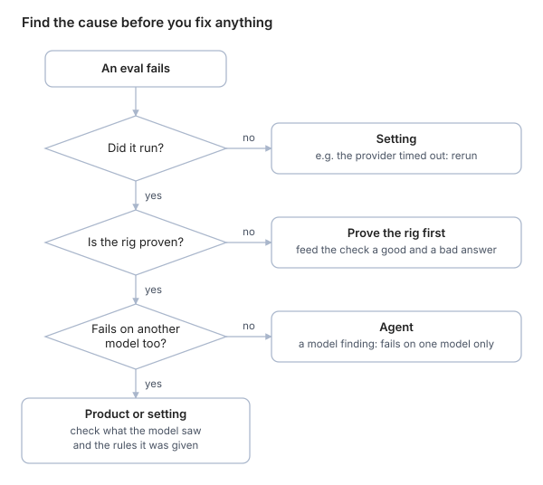

A failing eval has four possible causes: the **agent**, the **rig** (your fake world or your check), the **setting** (the case's wording, the network, provider errors) or the **product** (the code around the agent). Find which one, with evidence, before you fix anything.

## The four causes

| Cause | What it means | Example |
| --- | --- | --- |
| **Agent** | The model made a bad decision | It retyped a long link and changed one character, so the link was broken |
| **Rig** | The test itself is wrong | The check wanted the post title in every answer option, but the agent correctly put it in the question instead |
| **Setting** | The case or environment is unrealistic or noisy | The instruction said "post every update", so the agent posted progress messages: a fair reading. Or the provider timed out. |
| **Product** | Code around the model is broken | A helper stripped the status field from list results, so "count posts by status" was impossible |

Only the last one is a product bug; only the first is a model problem. Fixing the wrong thing wastes days.

Rule out the setting and the rig before you blame the model; a failure on every model points at your own code or your case.

## Steps, in order

1. **Read the failure message.** It should say what is wrong ("p17 changed; only drafts should change").
2. **Read the transcript:** every tool call, its arguments, its result, and the final reply.
3. **Find the first thing that went wrong.** Later steps are often just consequences; fix the first upstream failure ([Evals FAQ](https://hamel.dev/blog/posts/evals-faq/)).
4. **Check what the model actually saw.** Results can be transformed before the model reads them, so the raw tool result in your logs may not be what it got.
5. **Compare with the rules it was given.** Did the prompt say to do something else?
6. **Reproduce in the smallest form:** one case, one trial, debug output on.
7. **Rerun, then try another model.** Fails everywhere → likely product or rig. Fails on one model only → a model weakness, or a prompt only some models suit.
8. **Prove your rig without a model:** call the fake tool directly, feed the check a hand-written good and bad answer.
9. **Classify, then fix the right layer.**
10. **Compare before and after:** rerun at k trials and see the number move.

## Capture evidence before changing anything

If you change the case and rerun, the old failing trace is gone, and you can never say what caused it. Save the transcript first.

## Moving the goalposts

Changing a check right after it failed can be an honest correction or a way to make red go green. It is honest only when you have evidence the check was wrong ("the rule forbids *asking* the user for an id; this reply only *showed* one beside the post's name"), and you say that you changed it.

## Finding hotspots in many failures

For multi-step agents, a **transition failure matrix** shows where runs break: rows are the last step that succeeded, columns are the first step that failed, and each cell counts failures ([Evals FAQ](https://hamel.dev/blog/posts/evals-faq/)).

| Last success ↓ / first failure → | Find the post | Update it | Notify Slack |
| --- | --- | --- | --- |
| Start | 2 | — | — |
| Find the post | — | **11** | — |
| Update it | — | — | 1 |

Here most failures happen between finding the post and updating it, so start there.

## Say it in an interview

> "When an eval fails I classify the cause before fixing anything: agent, rig, setting or product. I read the transcript, find the first upstream failure, check what the model actually saw, prove the rig with model-free tests, and rerun on another model. Then I fix the right layer and confirm with a before-and-after run. Several of my 'agent failures' turned out to be my own checks."

## Check yourself

1. A case fails on GPT and passes on Claude. Which cause does that point to?
2. Why look for the first upstream failure rather than the last?
3. When is changing a failed check legitimate?
