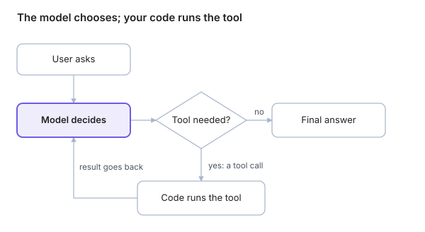

An AI agent is a language model running in a loop: it decides which tool to call, reads the result, and repeats until the task is done.

## The three parts

| Part | Plain meaning | In Blog Assistant |
| --- | --- | --- |
| **Model** | The brain. It reads the conversation and decides the next move. | An LLM such as GPT or Claude |
| **Tools** | The hands. Functions the model can ask your code to run. | `list_posts`, `update_post`, `send_slack` |
| **Loop** | The engine. It keeps asking the model "what next?" until it gives a final answer. | The agent framework (Mastra, LangGraph, etc.) |

## The loop, step by step

Request: *"Move every Draft post to In Review."*

1. The model reads the request and the list of tools it may use.
2. It replies with a **tool call**, not text: `list_posts(page=1)`.
3. Your code runs the tool and returns the result: 12 posts, 3 of them Draft.
4. The model reads the result and calls `update_post(id=..., status="In Review")`, once per draft.
5. With nothing left to do, it replies in text: *"Done: 3 posts moved to In Review."* The loop stops.

The model only chooses. Your code runs each tool and hands the result back, and the loop goes round until the model answers.

## Workflow or agent?

Anthropic's guide splits "agentic systems" into two kinds ([Building effective agents](https://www.anthropic.com/engineering/building-effective-agents)):

|  | Workflow | Agent |
| --- | --- | --- |
| Who decides the steps | Your code, fixed in advance | The model, at run time |
| Example | Always: list posts, then summarise them | Model chooses: search, list, update, or ask |
| Good for | Predictable, well-defined tasks | Open-ended tasks where steps can't be known in advance |
| Risk | Rigid | Errors compound; costs more; harder to test |

Common workflow patterns from that guide: **prompt chaining** (one call feeds the next), **routing** (classify, then send to a specialist), **parallelization** (run pieces at once, or vote), **orchestrator–workers** (one model splits work for others) and **evaluator–optimizer** (one model writes, another critiques).

## Words you must know

- **Tool calling (function calling):** the model outputs a structured request such as `{"name": "get_post", "arguments": {"id": "p42"}}`. Your code runs it; the model never runs code itself.
- **System prompt:** standing instructions the model sees on every turn, e.g. "Never delete posts."
- **Context window:** everything the model can see at once. Large tool results can overflow it.
- **Memory:** short-term (this conversation) and long-term (stored facts reused later).
- **Planning:** the agent writes a task list before acting, and ticks it off.
- **ReAct:** a common loop style: *reason* about what to do, *act* with a tool, *observe* the result, repeat.
- **Human-in-the-loop:** the agent pauses to ask a question (`ask_user`) or to get approval before a write.
- **Guardrails:** fast checks that block or fix bad inputs and outputs while the agent runs, e.g. a filter for personal data.
- **MCP (Model Context Protocol):** a standard way to plug external tools into an agent.
- **Multi-agent:** several agents working together, usually one orchestrator handing tasks to specialists.

## Say it in an interview

> "An agent is a model in a loop with tools. The model chooses the next action, the code executes it, and the result goes back to the model until the task is done. That freedom is what makes agents useful, and also what makes them hard to test."

## Check yourself

1. What is the difference between a workflow and an agent?
2. Who actually runs a tool: the model or your code?
3. Why might a large tool result be a problem for the model?
