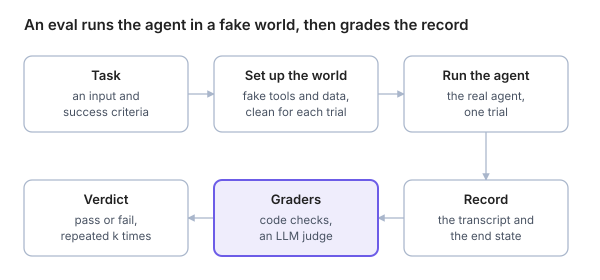

An eval is a test for an AI system: you give it an input, let it run, and grade what it did with clear logic ([Anthropic](https://anthropic.com/engineering/demystifying-evals-for-ai-agents)).

## Unit test, eval, benchmark

|  | Unit test | Eval | Benchmark |
| --- | --- | --- | --- |
| Tests | Code | The model's decisions inside your product | A model's general ability |
| Same input, same result? | Always | Not always | Not always |
| Speed and cost | Milliseconds, free | Seconds to minutes, costs tokens | Hours, costs tokens |
| Example | `parseDate("2026-10-25")` returns the right date | Does Blog Assistant update only the drafts? | SWE-bench: can a model fix real GitHub issues? |

**Rule of thumb:** if the behaviour is plain code with no model decision in it, write a unit test. Use evals only for what the model decides.

## The vocabulary (memorise this table)

| Term | Meaning | Blog Assistant example |
| --- | --- | --- |
| **Task** (case) | One test: an input plus success criteria | "Move every Draft post to In Review"; success = exactly the 3 drafts changed |
| **Trial** | One attempt at a task. Run several, because results vary. | Trial 1 passed, trial 2 passed, trial 3 failed |
| **Transcript** (trace, trajectory) | The full record of a trial: messages, tool calls, results | `list_posts` → `update_post` ×3 → reply |
| **Outcome** | The final state of the world after the trial | The 3 drafts now say In Review; nothing else changed |
| **Grader** (scorer) | Logic that scores one aspect of the trial | "Exactly the 3 draft posts changed" |
| **Eval harness** | The machinery that runs tasks, records them, grades and reports | A test runner plus a fake CMS |
| **Eval suite** | A group of tasks with a shared goal | "Writes" suite: 10 tasks about updating posts |

## Anatomy of one eval case

```text
id:        move-drafts-to-review
input:     "Move every Draft post to In Review."
world:     a fake CMS with 12 posts (3 Draft, 9 Published)
tools:     list_posts, update_post
check:     the 3 drafts are In Review AND the 9 others are unchanged
           AND update_post was called exactly 3 times
repeat:    3 trials; all 3 must pass
```

The case says **what a correct run must show**, not the exact words or steps the agent must use.



Each trial starts from a clean world, and the graders score the record it leaves: what the agent did and the state it left behind.

## Offline and online evals

|  | Offline | Online |
| --- | --- | --- |
| When | Before you ship, e.g. in CI | After you ship, on real traffic |
| Data | A fixed, curated set of cases | Samples of real user sessions |
| Catches | Regressions from prompt, model or tool changes | New kinds of input, drift, real-world tool failures |
| Example | Run 40 Blog Assistant cases before each release | Score 5% of yesterday's real sessions each morning |

The two feed each other: a failure found online becomes a new offline case ([Langfuse guide](https://langfuse.com/resources/engineering/ai-agent-evaluation.md)).

## Capability and regression evals

- **Capability evals** ask "what can it do?" They should start with a low pass rate, giving you a hill to climb.
- **Regression evals** ask "does it still do what it used to?" They should stay near 100%.
- A capability eval that reaches a high pass rate can "graduate" into the regression suite ([Anthropic](https://anthropic.com/engineering/demystifying-evals-for-ai-agents)).

## Say it in an interview

> "An eval runs the real agent on a task in a controlled environment, records the transcript and the final state, and grades them. A task can have several trials because results vary. Offline evals guard releases; online evals watch production; failures found online become new offline cases."

## Check yourself

1. What is the difference between a transcript and an outcome?
2. When should you write a unit test instead of an eval?
3. Why should a capability eval start with a low pass rate?
